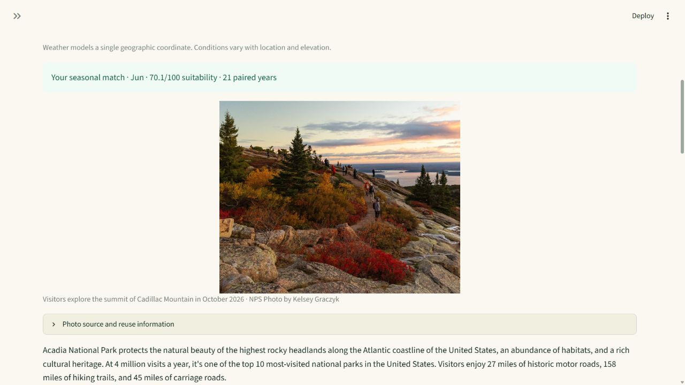
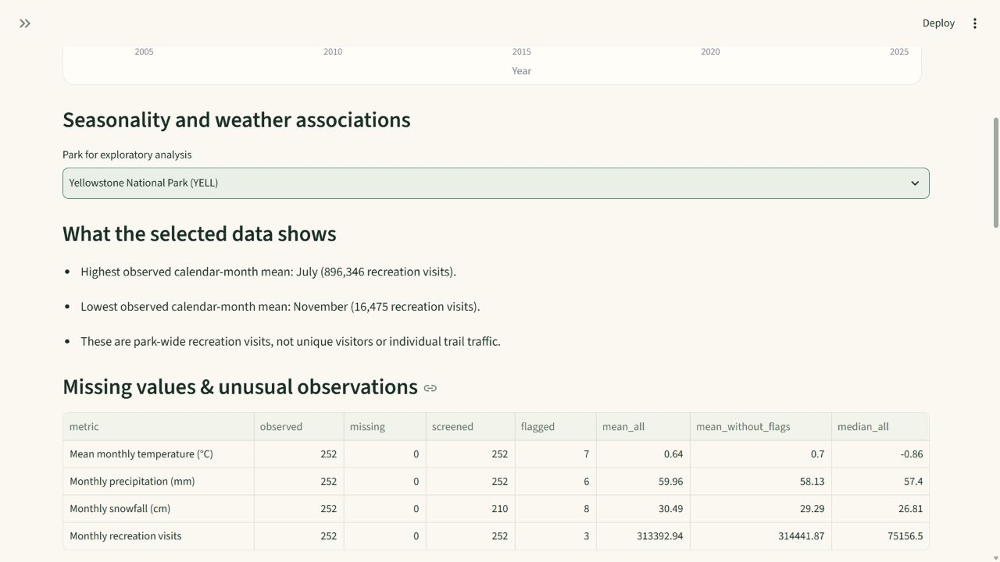
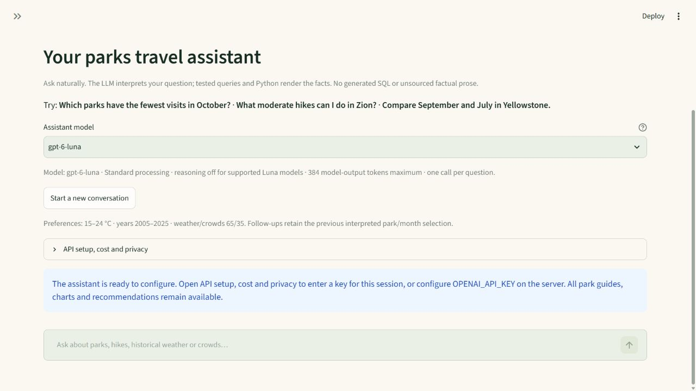

# National Parks Travel Planner

Programming for Data Science · Solo project · updated November 24, 2026

## Purpose and acquisition

The planner helps users decide where to go, what to do and when to visit using
official park information, verified hiking routes, historical weather and
recreation visits. It combines Python, Streamlit, pandas, Plotly, PyDeck and
PostgreSQL/Supabase. Research questions address seasonal crowd patterns, weather
comfort, differences between parks, and whether apparent weather–visitation
relationships remain after accounting for the annual cycle. No predictive
machine learning or forecasting is included.

NPS park metadata and recreation statistics are integrated with Open-Meteo daily
historical weather. JSON responses and source CSV/HTML snapshots are retained
with hashes and retrieval metadata. Transformations reconcile identifiers,
reshape monthly visitation, average daily mean temperature and sum daily
precipitation/snowfall. Weather units are °C, mm and cm. SEKI visitation sums
SEQU and KICA; its weather is one point, not an average over both parks.

The current read-only verification confirms 63 reporting records, 15,876 weather
months and 15,863 visitation months in 2005–2025. The 13 visitation gaps are
source-aligned and are not replaced with zero. The existing relational database,
advanced SQL and quality reports are preserved. A separate database-course
report discusses normalization and approval-dependent improvements.
Fresh Open-Meteo acquisition also stored 365 daily Acadia observations for 2025;
all 12 reaggregated months matched the stored weather within numeric tolerance.

Figure 1. Actual Streamlit park-guide view with responsive discovery controls and official park information.

## Analysis, missingness and results

The interface displays descriptive statistics, monthly charts, comparisons and
weighted recommendation scores. Recommendation components use paired-year
medians with a minimum evidence threshold. Missing/nonfinite or invalid values
are excluded from applicable calculations; observed zeros and plausible extremes
remain. Statistical outliers are flagged within each park/calendar month using
Tukey's 1.5-IQR rule, at least eight observed years and positive IQR. Zero-IQR and
small groups are explicitly unscreened. A mean-without-flags sensitivity summary
does not alter stored data or recommendation inputs.

For Yellowstone in 2005–2025, July has the highest calendar-month mean visitation
(896,346), while November has the lowest (16,475). Across 252 paired months,
temperature–visitation Spearman correlation is 0.855, falling to 0.074 after
calendar-month demeaning. This suggests much of the raw relationship tracks
seasonality; it is not a causal estimate. Long-term change, access and pandemic
disruptions may also matter. The seasonal screening flags three visitation
observations; retaining them produces a mean of 313,392.94 compared with
314,441.87 without flags. Flags are diagnostic, not proof of error.

Figure 2. Live-source Yellowstone findings and seasonal data-quality diagnostics.

## LLM, implementation and evaluation

OpenAI Responses API interpretation produces validated park, activity, month and preference plans. Fixed parameterized SELECTs retrieve historical evidence in read-only transactions. Broader planning questions retrieve official descriptions, activities, reviewed trails and available alerts rather than returning a generic capabilities message. A second bounded model request writes a concise natural-language explanation using those retrieved facts and citation IDs.

The application checks citation IDs, rejects model-generated links and new numeric strings, and attaches official URLs from evidence. Failed generations fall back to explicitly labeled source facts. These checks reduce unsupported answers but do not prove every sentence correct; inspectable evidence remains essential. Source facts, interpretation receipts and synthesis receipts are distinguished. Missing trail coverage does not erase historical weather and visitation answers.

The masked API key survives page navigation in memory and is never written to disk. A Forget control removes it; browser/server restarts end the session. Questions, public park evidence and short conversation context go to OpenAI; credentials for Supabase do not. Standard processing caps interpretation at 384 output tokens and explanation at 650. Only explicit temporary synthesis errors retry once; timeouts do not retry automatically. Actual cost depends on token use and provider rates.

The complete updated suite passed 62 tests with no failures, errors or skips, including read-only live database checks and a key-navigation regression. Provider unit tests are mocked and are separate from retained real API receipts. Earlier successful real GPT-6 Luna calls verified historical comparisons and the corrected climbing question. Updated live camping and combined Zion weather/crowd/hiking questions completed through separate planning and explanation API requests, with provider receipts in conversation_live_verification.json. Live NPS alerts require an optional key. Reviewed trail coverage remains 17 routes across six parks, with missing measurements and unrepresented parks explicitly acknowledged.

Figure 3. Assistant configuration view. Verified live API usage is documented separately in the accompanying evidence.

This is a solo submission with AI-assisted coding, testing and report preparation;
no teammate contributions are claimed. Engineering lessons include validating
join grains, separating missingness from zero, preserving source provenance,
distinguishing seasonal association from causality, and testing API failures.
The student should review this reflection and all generated code before submission.
Local Git commits document the finishing phases; GitHub publication and the
maximum-15-minute class demo remain final submission tasks.

Sources: NPS Visitor Use Statistics (irma.nps.gov/Stats); NPS developer API and
official park pages (nps.gov); Open-Meteo Historical Weather API
(open-meteo.com/en/docs/historical-weather-api); OpenAI Responses structured
outputs and model pricing (developers.openai.com). Reproducible commands,
provenance, tests and full limitations are in README and supporting documentation.
