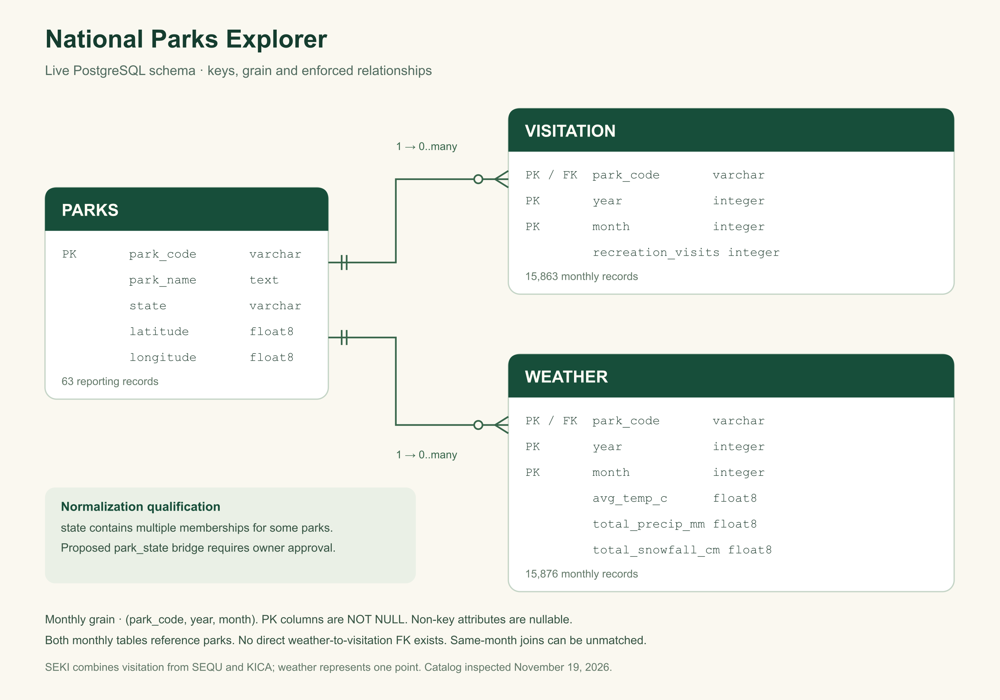

# National Parks Explorer
## A relational data platform for historical travel planning

Database design, reproducible ETL and verified derived information

Audit date November 19, 2026. Live snapshot uses PostgreSQL 17.11 and
repeatable-read, read-only transactions. Findings reflect this recorded
snapshot and the retained source files. No grade is predicted.

## 1. Purpose and research questions

National Parks Explorer helps travelers compare historical monthly weather
and recreation visitation when choosing a park and a travel season. It also
serves as a database project demonstrating how heterogeneous public sources
can be transformed into a relational model and converted into explainable
planning information.

The research questions are which months are relatively quiet within a park,
how seasonal visitation changes across parks and years, which calendar months
meet a traveler's temperature preferences, and how weather and crowd preferences
combine into a transparent suitability index. A further engineering question is
whether every displayed statistic can be traced to validated source records.

The current scope contains 63 park records, including combined Sequoia and
Kings Canyon under SEKI. Reporting units and officially designated park counts
have different semantics, so the application consistently uses park records.

## 2. Why a relational database fits

The data have two stable observational grains: one inventory record per park
code and one observation per park, year and month for each historical source.
A relational design supports a central park key, composite monthly keys,
referential integrity, exact joins and reproducible aggregation. It stores
park descriptions and coordinates once while allowing source coverage to differ.

A single flattened CSV would repeat park attributes and make update anomalies
more likely. Independent files remain valuable raw archives, but they do not
enforce foreign keys across datasets. The monthly relations can be joined when
both sources exist without requiring weather availability to depend on a
visitation report.

## 3. PostgreSQL and Supabase selection

PostgreSQL matches the workload through composite keys, transactions, foreign
keys, ordered-set aggregates, CTEs and window functions. These features support
the actual questions in the SQL collection. Supabase provides hosted PostgreSQL
and a managed connection surface, allowing the Streamlit app and the audit
runner to use the same relational source.

SQLite would simplify a single-file local demonstration but requires a different
deployment and concurrency arrangement for a shared remote application. MySQL
would also support this relational workload, with syntax and aggregate
adaptations for the existing PostgreSQL query collection. A document database
would fit raw API payload capture, while this project's monthly joins and
key constraints favor relational serving tables. PostGIS could support future
distance or polygon analysis, but the current map requires stored coordinates
and does not justify a spatial migration on its own.

The choice balances expressive SQL, hosted access and Python integration
against network dependency and database administration. Raw API JSON remains
an appropriate archival format upstream of the relational tables.
[Supabase database overview](https://supabase.com/docs/guides/database/overview)

## 4. Sources and historical collection

NPS park metadata supplies codes, names, state or territory memberships and
coordinates. The R script requests the NPS parks endpoint and selects the
project's designation categories, with explicit NPSA and REDW handling.
The retained metadata CSV matches all 63 live inventory rows.

Monthly recreation visits come from the NPS Visitor Use Statistics query-builder
export. Count strings are converted after removing thousands separators.
The Colab export also processes separately downloaded monthly-wide reports.
SEQU and KICA are summed by year and month to produce SEKI.

Open-Meteo historical daily mean temperature, precipitation and snowfall are
requested at each stored coordinate. Daily temperature is averaged into monthly
mean temperature. Daily precipitation and snowfall amounts are summed.
The historical target is January 2005 through December 2025.

NPS recreation visits follow park counting procedures and describe entries.
They are a proxy for crowd exposure. Open-Meteo values represent modeled
conditions at selected locations, with differences across elevation and terrain.
[NPS visitor-use definitions](https://www.nps.gov/subjects/socialscience/nps-visitor-use-statistics-definitions.htm)

## 5. Schema, dependencies and relationships

The parks primary key is park_code. The visitation and weather primary keys
are both (park_code, year, month). Each monthly relation has a validated
park_code foreign key to parks. PostgreSQL created a unique B-tree index for
each primary key. No additional indexes, unique constraints or domain CHECK
constraints were found in the inspected three-table schema.

The intended dependencies are park_code determining the inventory attributes,
and the full composite monthly key determining the measurements. The monthly
relations satisfy 3NF under these business rules. No measurement depends on
only part of its composite key.

The parks.state column needs a qualification. Values such as CA,NV and
ID,MT,WY encode multiple state memberships. Under atomic membership semantics,
a strict fully normalized design requires a state table and a park_state bridge
with a composite primary key. The current schema therefore has a documented
normalization gap, and the report does not certify the complete design as
strict 3NF. The proposed decomposition is supplied for owner review.

Each park can have zero or many monthly rows in either relation. Matching
monthly keys form an optional one-to-one analytical relationship. There is
no direct weather-to-visitation foreign key, which preserves independent
source coverage. Natural park codes are convenient integration keys, while
future source identity changes would benefit from dated mapping records.
[PostgreSQL 17 constraint behavior](https://www.postgresql.org/docs/17/ddl-constraints.html)

## 6. Reproducible ETL and idempotency

The reusable pipeline follows raw capture, strict transformation, immutable
local staging and read-only comparison. Raw files are retained by SHA-256 hash.
Fresh HTTP captures include request parameters, retrieval UTC time, returned
units and response payloads. The NPS key is passed in a request header and
excluded from those records.

Transformations normalize codes, parse dates and counts, enforce finite numeric
values, and reject impossible keys or conflicting duplicate observations.
SEKI transformation requires both components for every observed month. Daily
weather transformation requires unique dates, expected units and every day of
the calendar month. Missing daily values are rejected before aggregation.

Canonical outputs are sorted by their logical keys. Their content and source provenance determine
the staged run identifier. Repeating a run with identical inputs reuses the
same immutable files. A tested change planner reports new, unchanged,
conflicting and existing-only records against live tables. It has no database
write path.

If a live loader is approved later, database PKs and transactionally applied
ON CONFLICT handling should enforce concurrency-safe insertion of approved
new rows. Revised values require a reviewed correction policy. The original
Colab pre-insert existence check alone is insufficient for concurrent runs.

The original scripts have useful exploratory lineage but also interactive
file selection, notebook-specific state and permissive missing-day aggregation.
Original daily payloads were not retained. The new pipeline improves future
reproducibility while acknowledging this historical evidence boundary.
Detailed file and line references are in etl_lineage.md.

## 7. SQL and derived information

Eight parameterized PostgreSQL queries demonstrate the serving and analytical
workload. They execute in a single read-only repeatable-read snapshot with a
statement timeout. Parameter values are bound separately from SQL text.

The history query joins all three relations on the appropriate keys. The
least-crowded query aggregates calendar-month medians, applies a minimum
year count, and uses RANK to preserve ties. A window maximum expresses each
month as a percentage of that park's seasonal peak.

The seasonal query first selects complete twelve-month park-years, then uses
CASE to form seasonal totals and annual shares. Winter means January, February
and December of the same calendar year. The weather query reports averages,
support counts and sample temperature variability.

The suitability query uses a CTE pipeline for paired-year medians, coverage,
component scores and final ranking. Average tie ranks are constructed explicitly
so SQL agrees with the application's pandas logic. PERCENT_RANK alone would
use a different tied-rank convention.

A generated expected grid identifies absent monthly keys. LAG supports annual
change only across adjacent complete years. Finally, the SEKI query binds
retained component observations as JSON and uses a FULL JOIN to detect any
missing, extra or mismatched combined month.

Execution results, bound non-sensitive parameters and one EXPLAIN ANALYZE
plan are preserved in reports. The representative park-history query includes measured execution time and
buffer activity in its recorded plan. This is a diagnostic sample influenced
by caching and load. Deployment performance requires repeated workload measurement. The existing composite
indexes already support park-specific monthly ranges.

## 8. Suitability calculation and statistical interpretation

Every month uses medians across years with all four inputs available.
The default minimum is three paired years. Temperature receives full suitability
inside the preferred range and declines to zero at a 25 degree Celsius departure
from the nearest bound. Precipitation and snow component scores decline from
100 at zero to zero at 200 mm and 60 cm.

Weather combines temperature, precipitation and snowfall at 60%, 25% and 15%.
Crowd score is 100 minus a percentile position among eligible months within
the same park. Ties receive average ranks. The user's weather and crowd weights
are normalized by their sum. Discovery filters are applied after this seasonal
reference has been calculated.

The result is a configurable suitability index. It has no calibrated probability
interpretation. Cross-park crowd scores compare seasonal positions, and the
interface retains median visits to show differences in traffic scale. Thresholds
express a preference for mild, dry, low-snow outings and may suit other activities
poorly. Historical patterns also reflect closures, reporting changes and events.

## 9. Data quality and independent verification

The snapshot contains 63 park records, 15,863 visitation rows and 15,876 weather
rows. All observed PKs are unique. Required values, numeric domains, dates and
referential integrity pass the audit. Joining visitation to parks and weather
produces exactly 15,863 complete monthly records without cardinality inflation.

The expected grid has 15,876 park-months. Weather covers all of them. Visitation
is absent for Channel Islands in December 2005 and all twelve American Samoa
months in 2005. The retained NPS export has the same gaps. These absent records
remain distinct from observed zero visits.

All 15,611 direct-code source visitation rows match live data. All 252 SEKI
months equal SEQU plus KICA. All 756 default suitability results match SQL
and Python for medians, coverage, ranks, crowd percentiles and scores.
Weather chart means match SQL for all 756 profiles. Quiet-month ranks and
complete-year seasonal and annual calculations reconcile independently.

The older weather CSV overlaps 4,536 live months. Above a 1e-8 tolerance,
3,085 temperature values, 464 precipitation totals and 206 snowfall totals
differ. Maximum absolute differences are approximately 0.04194 C, 13.4 mm
and 2.38 cm. The available evidence does not establish the cause of every
difference. Exact load planning conservatively flags 4,334 rows, including
smaller floating differences.

A fresh Acadia 2025 capture contains 365 daily observations. Reaggregating it
produces 12 monthly rows matching the live table within 1e-8. This provides
direct validation for a representative full year. It cannot recreate missing
original daily archives for every park-year.
[Open-Meteo historical API and reanalysis](https://open-meteo.com/en/docs/historical-weather-api)

## 10. Application architecture and verification

Streamlit provides the interface. src/database.py opens a TLS PostgreSQL
connection and uses read-only repeatable-read snapshots. Source tables are
cached for ten minutes. A visible source caption identifies live PostgreSQL
mode, and a refresh control invalidates the data cache. Explicit CSV mode
remains available for offline inspection and is labeled in the interface.

src/analytics.py builds monthly profiles and associations.
src/recommendations.py computes suitability and discovery filters.
src/visualizations.py renders PyDeck maps and Plotly charts. The ETL and audit
modules are independently runnable command-line tools.

The app computes seasonal statistics in pandas after loading the small source
tables. The SQL collection demonstrates the equivalent database calculations
and verifies their parity. For larger datasets, selected aggregates could be
served directly from parameterized SQL to reduce transferred data.

Automated tests cover existing views, filters, unit conversion, missing values,
ties, daily aggregation and idempotency. Optional integration tests use the live
database, disable CSV mode, verify source status, reconcile scoring under
multiple preferences, and navigate Explore, rankings, comparison and EDA.
The professional Phase 1 interface remains the active application.

## 11. Tradeoffs and approval-dependent improvements

Composite natural keys encode the analytical grain clearly. Separate source
tables permit independent coverage, at the cost of explicit joins and complete-case
sample decisions. Nullable measures support uncertain source ingestion, but
strict serving-table quality benefits from agreed domain constraints.

The supplied connection role has write privileges even though the application
and audit use read-only transactions. RLS is disabled on the inspected tables.
The audit does not establish anonymous API access. A dedicated SELECT role and
an explicit review of API grants would improve deployment control.

Priority proposals are state-membership normalization, month and value checks,
appropriate required fields, a dedicated application role and retained ingestion
provenance. Additional indexes should follow measured workload needs.
All schema, privilege and data changes require owner approval.

Machine learning forecasting, live travel intelligence and the AI assistant
remain later-phase work. The present deliverable prioritizes database design,
ETL, SQL, verified derived information and application usefulness.

## 12. Rubric alignment and submission evidence

The 30% design/querying category is supported by catalog evidence, ER diagrams,
a normalization review, eight SQL queries and execution plans. The 25% ETL
category is supported by lineage, source hashes, reusable strict transformations,
immutable staged runs and read-only change plans.

The 20% accuracy category is supported by the quality report, expected-grid
checks, source reconciliation, SEKI validation and SQL/Python parity. The 15%
application category is supported by the existing interface and live integration
checks. Database selection and this report address the remaining two 5% categories.

The detailed rubric_checklist.md maps each requirement to repository evidence,
completion status and the next improvement. Remaining approval-dependent design
gaps and historical provenance limits are stated explicitly. The evidence package
supports an instructor's assessment without asserting a guaranteed score.

## References and reproducibility

Primary references are the PostgreSQL 17 constraints documentation, Supabase
database overview, NPS Visitor Use Statistics definitions and Open-Meteo
Historical Weather API linked above. Local source artifacts are identified by
filename and SHA-256 in reports/audit_results.json.

Run python -m src.audit with --source-directory pointing to the original
project folder and DATABASE_URL supplied through the environment. Run
python -m src.etl.verify_weather for the representative daily reaggregation.
Run python -m unittest discover -s tests -v for tests. Set RUN_LIVE_DB_TESTS=1
to include the read-only database integration checks. See README.md for
PowerShell examples and dependency setup.
